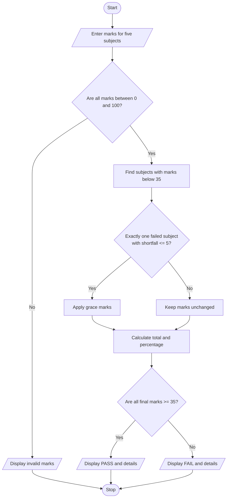

# Problem Statement
Write a Python program to accept marks in five subjects from a student and check whether the student has passed or failed.

Each subject has a maximum of 100 marks, and the minimum passing mark is 35. If a student fails in exactly one subject and is short of passing by a maximum of 5 marks, grace marks are awarded to make the student pass that subject.

The program should display the final marks, total marks, percentage, and result (PASS or FAIL).
# Algorithm
1. Start the program.
2. Read marks for five subjects from the user.
3. Check whether each subject mark is between 0 and 100.
4. Identify the subjects in which the student scored less than 35 marks.
5. If the student fails in exactly one subject and the shortfall is 5 marks or less, award the required grace marks.
6. Calculate the total marks obtained.
7. Calculate the percentage using the formula:
   Percentage = (Total Marks / 500) × 100
8. Check whether the student has scored at least 35 marks in every subject after applying grace marks.
9. Display the final marks, total, percentage, and result.
10. Stop the program.
# Mermaid Flowchart

# Python Source Code
marks = []
valid = True

# Input marks for five subjects
for i in range(5):
    mark = int(input("Enter marks for subject " + str(i + 1) + ": "))

    if mark < 0 or mark > 100:
        print("Invalid marks! Enter marks between 0 and 100.")
        valid = False
        break

    marks.append(mark)

if valid:
    # Find failed subjects
    failed = []

    for i in range(5):
        if marks[i] < 35:
            failed.append(i)

    # Apply grace marks if eligible
    if len(failed) == 1:
        i = failed[0]
        shortfall = 35 - marks[i]

        if shortfall <= 5:
            marks[i] = 35
            print("Grace marks applied:", shortfall)

    # Calculate total and percentage
    total = sum(marks)
    percentage = (total / 500) * 100

    # Display results
    print("Final Marks:", marks)
    print("Total Marks:", total, "/ 500")
    print("Percentage:", round(percentage, 2), "%")

    # Check final result
    if all(mark >= 35 for mark in marks):
        print("Result: PASS")
    else:
        print("Result: FAIL")
  # Sample Input   
  Enter marks for subject 1: 70
Enter marks for subject 2: 65
Enter marks for subject 3: 33
Enter marks for subject 4: 80
Enter marks for subject 5: 75
# Expected Output
Grace marks applied: 2
Final Marks: [70, 65, 35, 80, 75]
Total Marks: 325 / 500
Percentage: 65.0 %
Result: PASS
