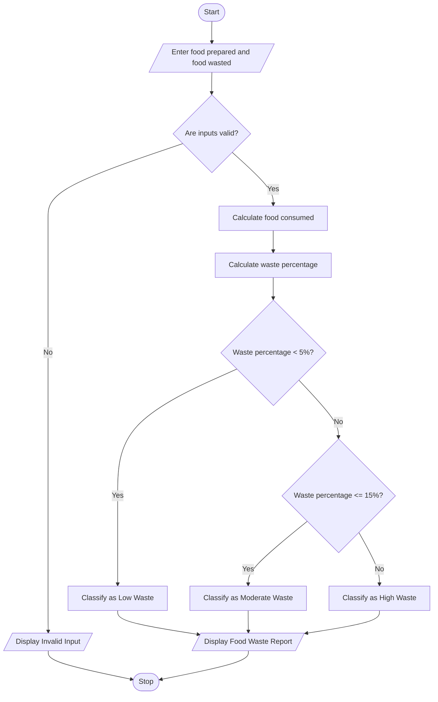

# Problem Statement
Develop a Python program to monitor food waste in a canteen or restaurant. The program should accept the quantity of food prepared and the quantity of food wasted each day.

The program should:
- Accept the total quantity of food prepared in kilograms.
- Accept the quantity of food wasted in kilograms.
- Calculate the quantity of food consumed.
- Calculate the food waste percentage.
- Classify food waste as Low, Moderate, or High.
- Display the food waste report.
Waste classification rules:
- Waste percentage below 5%: Low Waste
- Waste percentage from 5% to 15%: Moderate Waste
- Waste percentage above 15%: High Waste
# Algorithm
Step 1: Start the program.

Step 2: Input the total quantity of food prepared in kilograms.

Step 3: Input the quantity of food wasted in kilograms.

Step 4: Validate the inputs:
- Total food prepared must be greater than zero.
- Food wasted must not be negative or greater than the total food prepared.
Step 5: Calculate the quantity of food consumed.
\[
\text{Food Consumed}=\text{Food Prepared}-\text{Food Wasted}
\]
Step 6: Calculate the food waste percentage.
\[
\text{Waste Percentage}=
\frac{\text{Food Wasted}}{\text{Food Prepared}}\times100
\]
Step 7: Classify the food waste:
- If the waste percentage is below 5%, classify it as Low Waste.
- If the waste percentage is between 5% and 15%, classify it as Moderate Waste.
- If the waste percentage is above 15%, classify it as High Waste.
Step 8: Display the food prepared, food consumed, food wasted, waste percentage, and waste classification.

Step 9: Stop the program.
# Mermaid Flowchart

 # Python Source Code  
 # Food Waste Monitoring System

prepared = float(input("Enter food prepared (kg): "))
wasted = float(input("Enter food wasted (kg): "))

if prepared <= 0 or wasted < 0 or wasted > prepared:
    print("Invalid input! Enter valid food quantities.")

else:
    # Calculate food consumed
    consumed = prepared - wasted

    # Calculate waste percentage
    percentage = (wasted / prepared) * 100

    # Classify food waste
    if percentage < 5:
        status = "Low Waste"
    elif percentage <= 15:
        status = "Moderate Waste"
    else:
        status = "High Waste"

    # Display report
    print("\n----- FOOD WASTE REPORT -----")
    print("Food Prepared:", prepared, "kg")
    print("Food Consumed:", round(consumed, 2), "kg")
    print("Food Wasted:", wasted, "kg")
    print("Waste Percentage:", round(percentage, 2), "%")
    print("Waste Classification:", status)
# Sample Input
    Enter food prepared (kg): 100
# Sample Output
    ----- FOOD WASTE REPORT -----
Food Prepared: 100.0 kg
Food Consumed: 88.0 kg
Food Wasted: 12.0 kg
Waste Percentage: 12.0 %
Waste Classification: Moderate Waste
Enter food wasted (kg): 12
# screenshot
