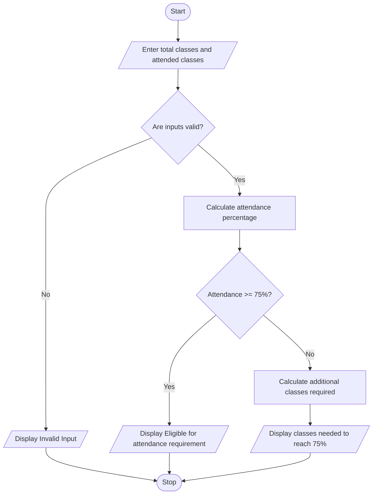

# Problem Statement
Develop a Python program to calculate a student's attendance percentage and determine how many additional classes the student must attend to reach the minimum required attendance percentage.

The program should:
- Accept the total number of classes conducted and the number of classes attended.
- Calculate the current attendance percentage.
- Check whether the student meets the minimum attendance requirement of 75%.
- If attendance is below 75%, calculate the minimum number of consecutive upcoming classes the student must attend without being absent to reach 75%.
- Display the current attendance percentage and the result.
# Algorithm
Step 1: Start the program.

Step 2: Input the total number of classes conducted.

Step 3: Input the number of classes attended.

Step 4: Check whether the inputs are valid:
- Total classes must be greater than zero.
- Classes attended must be between zero and total classes conducted.
Step 5: Calculate the current attendance percentage.
\[
\text{Attendance Percentage}=\frac{\text{Classes Attended}}{\text{Total Classes}}\times100
\]
Step 6: Check whether the attendance percentage is at least 75%.

Step 7:
- If attendance is 75% or above, display that the student meets the attendance requirement.
- Otherwise, calculate the minimum additional classes the student must attend consecutively to reach 75%.
\[
\text{Additional Classes}=
\left\lceil\frac{75T-100A}{25}\right\rceil
\]
Here, \(T\) is the total number of classes conducted and \(A\) is the number of classes attended. The ceiling function means rounding up to the next whole number.

Step 8: Display the attendance percentage and the required result.

Step 9: Stop the program.
# Mermaid Flowchart

# Python Source Code
import math

# Input
total = int(input("Enter total number of classes conducted: "))
attended = int(input("Enter number of classes attended: "))

# Validate input
if total <= 0 or attended < 0 or attended > total:
    print("Invalid input! Please enter valid class details.")

else:
    # Calculate current attendance
    percentage = (attended / total) * 100

    print("Current Attendance:", round(percentage, 2), "%")

    # Check attendance requirement
    if percentage >= 75:
        print("Status: Attendance requirement satisfied.")
        print("Additional classes required: 0")

    else:
        # Calculate minimum additional classes needed
        required = math.ceil((75 * total - 100 * attended) / 25)

        print("Status: Attendance below 75%.")
        print("Additional classes to attend:", required)
  # Sample Input 
  Enter total number of classes conducted: 100
Enter number of classes attended: 60
# Sample Output
Current Attendance: 60.0 %
Status: Attendance below 75%.
Additional classes to attend: 60
# screenshot
