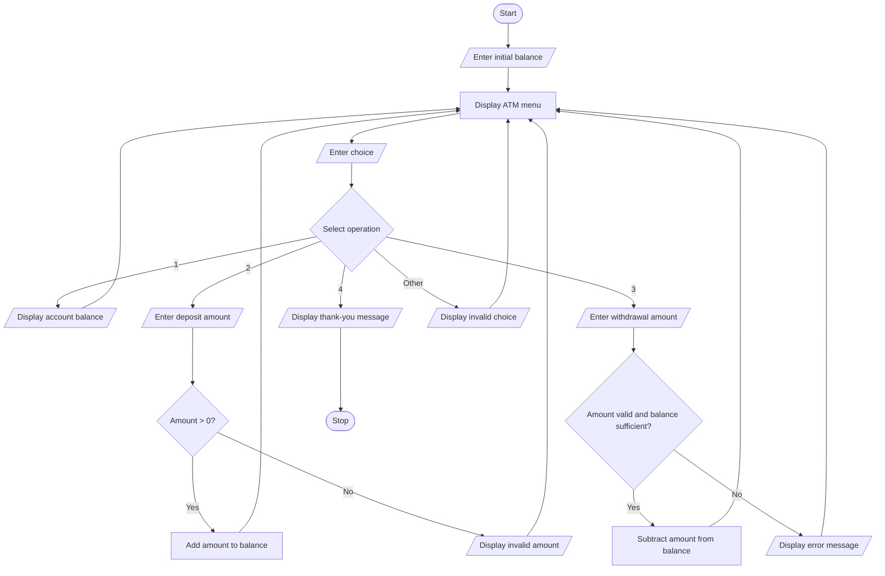

# Problem Statement
Develop a Python program to simulate an ATM transaction sequence. The program should allow a user to check their account balance, deposit money, withdraw money, and exit the ATM.

The program should:
- Accept the initial account balance.
- Display a menu with different transaction options.
- Allow the user to check the balance.
- Allow the user to deposit money into the account.
- Allow the user to withdraw money if sufficient balance is available.
- Display an error message for invalid amounts or insufficient balance.
- Continue performing transactions until the user chooses to exit.
# Algorithm
Step 1: Start the program.

Step 2: Enter the initial account balance.

Step 3: Display the ATM menu:
1. Check Balance
2. Deposit Money
3. Withdraw Money
4. Exit
Step 4: Accept the user's choice.

Step 5: Perform the selected operation:
- Choice 1: Display the current account balance.
- Choice 2: Enter the deposit amount. If the amount is positive, add it to the balance.
- Choice 3: Enter the withdrawal amount. If the amount is positive and does not exceed the balance, subtract it from the balance. Otherwise, display an error message.
- Choice 4: Display a thank-you message and terminate the program.
Step 6: If the choice is invalid, display an error message.

Step 7: Repeat Steps 3–6 until the user chooses Exit.

Step 8: Stop the program.
# Mermaid Flowchart

 #  Python Source Code

    balance = float(input("Enter initial account balance: "))

if balance < 0:
    print("Invalid initial balance.")

else:
    while True:
        print("\n----- ATM MENU -----")
        print("1. Check Balance")
        print("2. Deposit Money")
        print("3. Withdraw Money")
        print("4. Exit")

        choice = input("Enter your choice: ")

        if choice == "1":
            print("Current Balance: Rs.", round(balance, 2))

        elif choice == "2":
            amount = float(input("Enter deposit amount: "))

            if amount > 0:
                balance += amount
                print("Deposit successful.")
                print("Updated Balance: Rs.", round(balance, 2))
            else:
                print("Invalid deposit amount.")

        elif choice == "3":
            amount = float(input("Enter withdrawal amount: "))

            if amount <= 0:
                print("Invalid withdrawal amount.")
            elif amount <= balance:
                balance -= amount
                print("Withdrawal successful.")
                print("Updated Balance: Rs.", round(balance, 2))
            else:
                print("Insufficient balance.")

        elif choice == "4":
            print("Thank you for using the ATM!")
            break

        else:
            print("Invalid choice. Please try again.")

 # Sample Input  
          Enter initial account balance: 5000

Enter your choice: 1

Enter your choice: 2
Enter deposit amount: 1000

Enter your choice: 3
Enter withdrawal amount: 2000

Enter your choice: 1

Enter your choice: 4
# Sample Output
----- ATM MENU -----
1. Check Balance
2. Deposit Money
3. Withdraw Money
4. Exit
Enter your choice: 1
Current Balance: Rs. 5000.0

----- ATM MENU -----
1. Check Balance
2. Deposit Money
3. Withdraw Money
4. Exit
Enter your choice: 2
Enter deposit amount: 1000
Deposit successful.
Updated Balance: Rs. 6000.0

----- ATM MENU -----
1. Check Balance
2. Deposit Money
3. Withdraw Money
4. Exit
Enter your choice: 3
Enter withdrawal amount: 2000
Withdrawal successful.
Updated Balance: Rs. 4000.0

----- ATM MENU -----
1. Check Balance
2. Deposit Money
3. Withdraw Money
4. Exit
Enter your choice: 1
Current Balance: Rs. 4000.0

----- ATM MENU -----
1. Check Balance
2. Deposit Money
3. Withdraw Money
4. Exit
Enter your choice: 4
Thank you for using the ATM!
# screenshot
