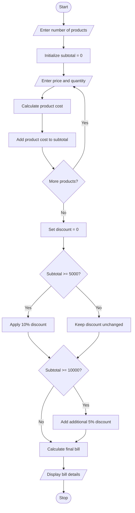

# Problem Statement
Develop a Python program to generate a retail bill by calculating the total purchase amount and applying multiple discount rules.

The program should:
- Accept the number of products purchased.
- Accept the price and quantity of each product.
- Calculate the subtotal of all products.
- Apply a 10% discount if the subtotal is ₹5,000 or more.
- Apply an additional 5% discount if the subtotal is ₹10,000 or more.
- Calculate the final bill amount after discounts.
- Display the subtotal, discounts, and final amount payable.
# Algorithm
Step 1: Start the program.

Step 2: Input the number of products purchased.

Step 3: Initialize the subtotal to zero.

Step 4: For each product:
- Enter the product price.
- Enter the product quantity.
- Calculate the product cost using price × quantity.
- Add the product cost to the subtotal.
Step 5: Check the subtotal:
- If the subtotal is ₹5,000 or more, apply a 10% discount.
- If the subtotal is ₹10,000 or more, apply an additional 5% discount.
Step 6: Calculate the total discount.

Step 7: Calculate the final bill amount by subtracting the total discount from the subtotal.

Step 8: Display the subtotal, discount amount, and final bill.

Step 9: Stop the program.
# Mermaid Flowchart

# Python Source Code
   # Retail Billing with Multiple Discount Rules

n = int(input("Enter number of products: "))

subtotal = 0

for i in range(n):
    print("\nProduct", i + 1)

    price = float(input("Enter product price: "))
    quantity = int(input("Enter quantity: "))

    if price < 0 or quantity <= 0:
        print("Invalid price or quantity.")
        break

    subtotal += price * quantity

else:
    discount = 0

    # Apply discount rules
    if subtotal >= 5000:
        discount += subtotal * 0.10

    if subtotal >= 10000:
        discount += subtotal * 0.05

    final_bill = subtotal - discount

    # Display bill
    print("\n----- RETAIL BILL -----")
    print("Subtotal: Rs.", round(subtotal, 2))
    print("Total Discount: Rs.", round(discount, 2))
    print("Final Bill Amount: Rs.", round(final_bill, 2))
  # Sample Input
    Enter number of products: 3

Product 1
Enter product price: 2000
Enter quantity: 2

Product 2
Enter product price: 1500
Enter quantity: 2

Product 3
Enter product price: 1000
Enter quantity: 1
# Sample Output
----- RETAIL BILL -----
Subtotal: Rs. 8000.0
Total Discount: Rs. 800.0
Final Bill Amount: Rs. 7200.0
