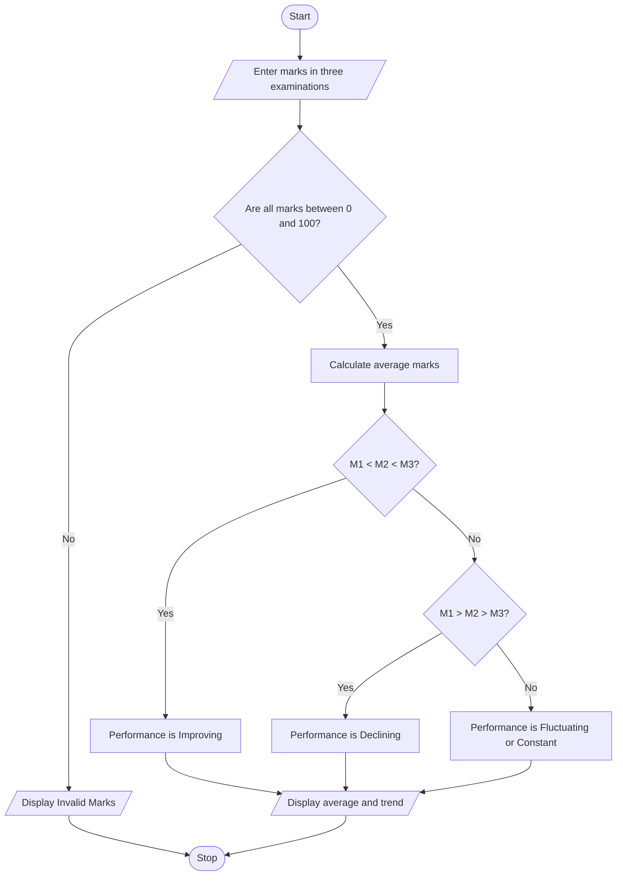

# Problem Statement
Develop a Python program to analyze a student's academic performance over multiple examinations. The program should accept the student's marks in three examinations, calculate the average marks, and identify whether the student's performance is improving, declining, or remaining constant.

The program should:
- Accept marks obtained in three examinations.
- Validate that marks are between 0 and 100.
- Calculate the average marks.
- Compare marks between consecutive examinations.
- Display whether the student's performance is improving, declining, or constant.
- Display the average marks and overall performance.
  # Algorithm
Step 1: Start the program.

Step 2: Input marks obtained in the first, second, and third examinations.

Step 3: Check whether all marks are between 0 and 100. If not, display an invalid input message.

Step 4: Calculate the average marks.
\[
\text{Average}=\frac{M_1+M_2+M_3}{3}
\]
Here, \(M_1\), \(M_2\), and \(M_3\) represent the marks obtained in the three examinations.

Step 5: Compare the marks:
- If \(M_1 < M_2 < M_3\), performance is improving.
- If \(M_1 > M_2 > M_3\), performance is declining.
- Otherwise, performance is fluctuating or remaining constant.
Step 6: Display the marks, average, and performance trend.

Step 7: Stop the program.
# Mermaid Flowchart

# Python Source Code
# Student Performance Trend Analysis

m1 = float(input("Enter marks in Examination 1: "))
m2 = float(input("Enter marks in Examination 2: "))
m3 = float(input("Enter marks in Examination 3: "))

if not (0 <= m1 <= 100 and
        0 <= m2 <= 100 and
        0 <= m3 <= 100):
    print("Invalid marks! Enter marks between 0 and 100.")

else:
    average = (m1 + m2 + m3) / 3

    print("\n----- STUDENT PERFORMANCE -----")
    print("Examination 1:", m1)
    print("Examination 2:", m2)
    print("Examination 3:", m3)
    print("Average Marks:", round(average, 2))

    if m1 < m2 < m3:
        print("Performance Trend: Improving")

    elif m1 > m2 > m3:
        print("Performance Trend: Declining")

    elif m1 == m2 == m3:
        print("Performance Trend: Constant")

    else:
        print("Performance Trend: Fluctuating")
# Sample Input
        Enter marks in Examination 1: 60
Enter marks in Examination 2: 70
Enter marks in Examination 3: 85
# Sample Output
----- STUDENT PERFORMANCE -----
Examination 1: 60.0
Examination 2: 70.0
Examination 3: 85.0
Average Marks: 71.67
Performance Trend: Improving
# screenshot
