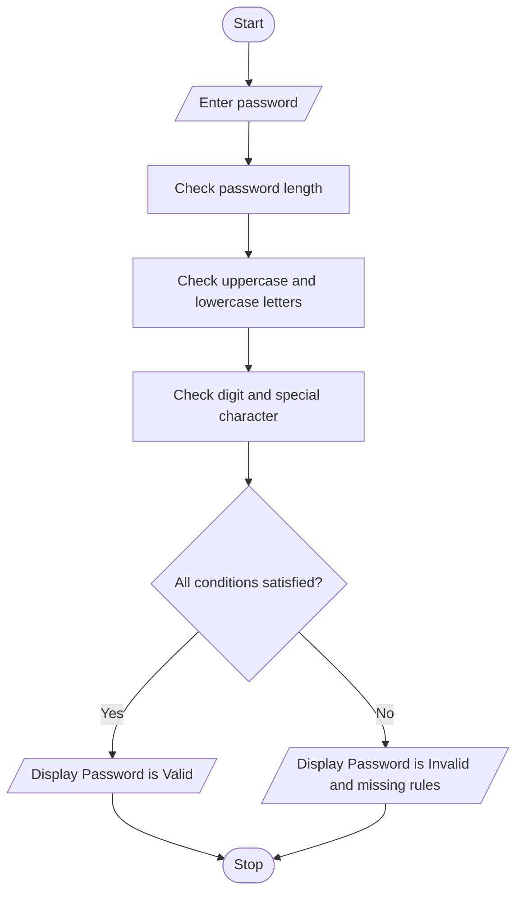

# Problem Statement
Develop a Python program to validate a password based on predefined password security rules.

The program should check whether the password satisfies the following requirements:
- The password must contain at least 8 characters.
- It must contain at least one uppercase letter.
- It must contain at least one lowercase letter.
- It must contain at least one digit.
- It must contain at least one special character (such as @, #, $, or !).
If all conditions are satisfied, display "Password is Valid". Otherwise, display "Password is Invalid" along with the requirements that are not satisfied.
# Algorithm
Step 1: Start the program.

Step 2: Accept a password from the user.

Step 3: Check whether the password contains at least 8 characters.

Step 4: Check whether it contains at least one uppercase letter.

Step 5: Check whether it contains at least one lowercase letter.

Step 6: Check whether it contains at least one digit.

Step 7: Check whether it contains at least one special character.

Step 8: If all conditions are satisfied, display "Password is Valid".

Step 9: Otherwise, display "Password is Invalid" and list the requirements that are not satisfied.

Step 10: Stop the program.
# Mermaid Flowchart

  # Python Source Code
    # Password Policy Validation Engine

import string

password = input("Enter your password: ")

errors = []

# Check password length
if len(password) < 8:
    errors.append("Password must contain at least 8 characters.")

# Check uppercase letter
if not any(ch.isupper() for ch in password):
    errors.append("Password must contain an uppercase letter.")

# Check lowercase letter
if not any(ch.islower() for ch in password):
    errors.append("Password must contain a lowercase letter.")

# Check digit
if not any(ch.isdigit() for ch in password):
    errors.append("Password must contain a digit.")

# Check special character
if not any(ch in string.punctuation for ch in password):
    errors.append("Password must contain a special character.")

# Display result
if len(errors) == 0:
    print("Password is Valid")
else:
    print("Password is Invalid")
    print("Reasons:")
    for error in errors:
        print("-", error)
  # Sample Input  
    Enter your password: Hello@123
  # Sample Output
    Password is Valid
   # screenshot
