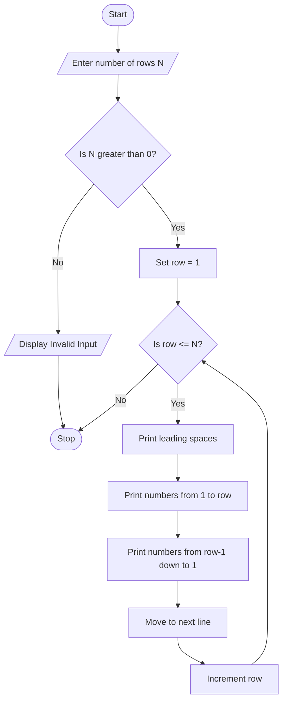

# Problem Statement
Develop a Python program to generate an advanced numeric pattern based on the number of rows entered by the user.

The program should:
- Accept the number of rows from the user.
- Generate a number pyramid pattern.
- Display numbers in increasing order in each row.
- Arrange the numbers symmetrically to form a pyramid.
- Validate the input and display an appropriate message if the number of rows is invalid.
Example: If the user enters 5, the program generates the following numeric pattern.
  # Algorithm
Step 1: Start the program.

Step 2: Input the number of rows.

Step 3: Check whether the number of rows is greater than zero.

Step 4: If the input is invalid, display an error message.

Step 5: Otherwise, repeat the following steps for each row from 1 to N:
- Print spaces to align the numbers in a pyramid shape.
- Print numbers from 1 to the current row number.
- Print numbers in decreasing order from the current row number minus 1 to 1.
Step 6: Move to the next row and repeat until all rows are printed.

Step 7: Stop the program.
# Mermaid Flowchart

  # Python Source Code
    # Advanced Numeric Pattern Generator

n = int(input("Enter number of rows: "))

if n <= 0:
    print("Invalid input! Enter a positive number.")

else:
    for i in range(1, n + 1):

        # Print leading spaces
        print(" " * (n - i), end="")

        # Print increasing numbers
        for j in range(1, i + 1):
            print(j, end="")

        # Print decreasing numbers
        for j in range(i - 1, 0, -1):
            print(j, end="")

        print()
  # Sample Input
           Enter number of rows: 5
# Sample Output
            1
   121
  12321
 1234321
123454321
# screenshot
