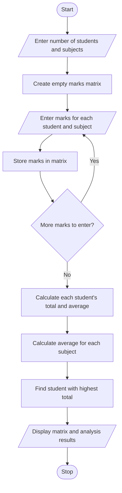

# Problem Statement
Develop a Python program to analyze student marks using a two-dimensional matrix. The program should accept marks for multiple students across multiple subjects and perform various operations on the marks matrix.

The program should:
- Accept the number of students and subjects.
- Store the marks of each student in a two-dimensional list (matrix).
- Calculate the total and average marks of each student.
- Calculate the average marks for each subject.
- Identify the student with the highest total marks.
- Display the marks matrix and analysis results.
# Algorithm
Step 1: Start the program.

Step 2: Input the number of students and subjects.

Step 3: Create an empty matrix to store student marks.

Step 4: Input marks for each student in every subject and store them in the matrix.

Step 5: Calculate the total marks of each student by adding marks across all subjects.

Step 6: Calculate the average marks of each student.

Step 7: Calculate the average marks for each subject.

Step 8: Identify the student who obtained the highest total marks.

Step 9: Display the marks matrix, student totals, student averages, subject averages, and top-performing student.

Step 10: Stop the program.
# Mermaid Flowchart

# Python Source Code
   # Student Marks Matrix Analysis

students = int(input("Enter number of students: "))
subjects = int(input("Enter number of subjects: "))

if students <= 0 or subjects <= 0:
    print("Invalid input! Enter positive numbers.")

else:
    marks = []

    # Input marks
    for i in range(students):
        row = []
        print("\nEnter marks for Student", i + 1)

        for j in range(subjects):
            mark = float(input("Subject " + str(j + 1) + ": "))

            if mark < 0 or mark > 100:
                print("Invalid marks! Marks must be between 0 and 100.")
                break

            row.append(mark)

        if len(row) != subjects:
            break

        marks.append(row)

    # Analyze marks if all inputs are valid
    if len(marks) == students:
        totals = []
        averages = []

        for row in marks:
            total = sum(row)
            totals.append(total)
            averages.append(total / subjects)

        # Calculate subject averages
        subject_averages = []

        for j in range(subjects):
            total = 0

            for i in range(students):
                total += marks[i][j]

            subject_averages.append(total / students)

        # Find top student
        top_index = totals.index(max(totals))

        # Display results
        print("\n----- MARKS MATRIX -----")
        for row in marks:
            print(row)

        print("\nStudent Totals:", totals)
        print("Student Averages:", averages)
        print("Subject Averages:", subject_averages)
        print("Top Student: Student", top_index + 1)
        print("Highest Total:", totals[top_index])
  # Sample Input
        Enter number of students: 3
Enter number of subjects: 3

Enter marks for Student 1
Subject 1: 80
Subject 2: 75
Subject 3: 90

Enter marks for Student 2
Subject 1: 85
Subject 2: 90
Subject 3: 80

Enter marks for Student 3
Subject 1: 70
Subject 2: 85
Subject 3: 75
# Sample Output
----- MARKS MATRIX -----
[80.0, 75.0, 90.0]
[85.0, 90.0, 80.0]
[70.0, 85.0, 75.0]

Student Totals: [245.0, 255.0, 230.0]
Student Averages: [81.66666666666667, 85.0, 76.66666666666667]
Subject Averages: [78.33333333333333, 83.33333333333333, 81.66666666666667]
Top Student: Student 2
Highest Total: 255.0
# screenshot
