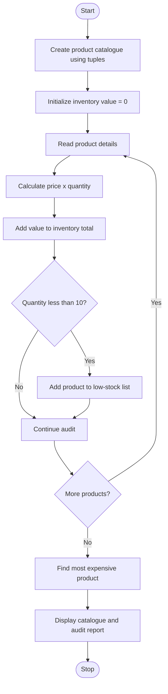

# Problem Statement
Develop a Python program to maintain and audit a product catalogue using tuples. Each product is represented by a tuple containing its product ID, product name, price, and available stock quantity.

The program should:
- Store product details using tuples.
- Display all products in the catalogue.
- Identify products with low stock.
- Calculate the total value of the available inventory.
- Find the most expensive product.
- Display the audit report.
Low-stock rule: A product is considered low in stock when its available quantity is less than 10 units.
# Algorithm
Step 1: Start the program.

Step 2: Create a catalogue containing product details as tuples.

Step 3: Display all products with their ID, name, price, and quantity.

Step 4: Initialize the total inventory value to zero.

Step 5: For each product:
- Calculate inventory value using price × quantity.
- Add the value to the total inventory value.
- Check whether the quantity is less than 10.
- If it is less than 10, add the product to the low-stock list.
Step 6: Identify the product with the highest price.

Step 7: Display the complete product catalogue, low-stock products, total inventory value, and most expensive product.

Step 8: Stop the program.
# Mermaid Flowchart

  # Python Source Code
    # Tuple-Based Product Catalogue Audit

products = (
    (101, "Pen", 10, 50),
    (102, "Notebook", 50, 5),
    (103, "School Bag", 800, 8),
    (104, "Pencil", 5, 100)
)

total_value = 0
low_stock = []

print("----- PRODUCT CATALOGUE -----")

for product in products:
    pid, name, price, quantity = product

    print("ID:", pid, "| Name:", name,
          "| Price: Rs.", price,
          "| Quantity:", quantity)

    total_value += price * quantity

    if quantity < 10:
        low_stock.append(product)

# Find the most expensive product
expensive = max(products, key=lambda p: p[2])

print("\n----- AUDIT REPORT -----")

print("\nLow-Stock Products:")
if low_stock:
    for product in low_stock:
        print(product[1], "- Quantity:", product[3])
else:
    print("No low-stock products.")

print("\nTotal Inventory Value: Rs.", total_value)

print("Most Expensive Product:", expensive[1])
print("Highest Price: Rs.", expensive[2])
# Sample Input
| Product ID | Product Name | Price (₹) | Quantity |
|---:|---|---:|---:|
| 101 | Pen | 10 | 50 |
| 102 | Notebook | 50 | 5 |
| 103 | School Bag | 800 | 8 |
| 104 | Pencil | 5 | 100 |
# Sample Output
----- PRODUCT CATALOGUE -----
ID: 101 | Name: Pen | Price: Rs. 10 | Quantity: 50
ID: 102 | Name: Notebook | Price: Rs. 50 | Quantity: 5
ID: 103 | Name: School Bag | Price: Rs. 800 | Quantity: 8
ID: 104 | Name: Pencil | Price: Rs. 5 | Quantity: 100

----- AUDIT REPORT -----

Low-Stock Products:
Notebook - Quantity: 5
School Bag - Quantity: 8

Total Inventory Value: Rs. 7650
Most Expensive Product: School Bag
Highest Price: Rs. 800
# screenshot
